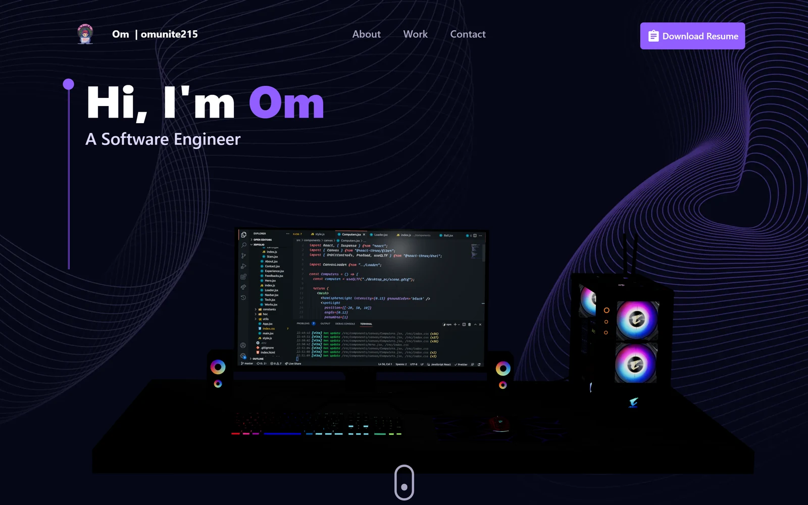
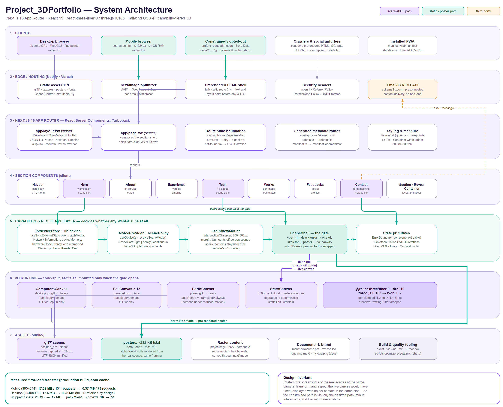

<a id="readme-top"></a>

<!-- BADGES (reference-style; definitions at the bottom of the file) -->
[![Contributors][contributors-shield]][contributors-url]
[![Forks][forks-shield]][forks-url]
[![Stargazers][stars-shield]][stars-url]
[![Issues][issues-shield]][issues-url]
[![MIT License][license-shield]][license-url]
[![LinkedIn][linkedin-shield]][linkedin-url]

<!-- HEADER (text title + tagline; logo lives at the END) -->
<div align="center">
  <h1>3D Portfolio</h1>
  <p><b>An interactive 3D developer portfolio that still loads on the phone in your pocket.</b></p>
  <p>
    <a href="https://portfoliobyompatel.netlify.app/"><strong>View Demo »</strong></a>
    &nbsp;·&nbsp;
    <a href="https://github.com/omunite215/Project_3DPortfolio/issues/new?labels=bug">Report Bug</a>
    &nbsp;·&nbsp;
    <a href="https://github.com/omunite215/Project_3DPortfolio/issues/new?labels=enhancement">Request Feature</a>
  </p>
</div>

<!-- TABLE OF CONTENTS -->
<details>
  <summary>Table of Contents</summary>
  <ol>
    <li><a href="#about-the-project">About The Project</a>
      <ul><li><a href="#built-with">Built With</a></li></ul>
    </li>
    <li><a href="#features">Features</a></li>
    <li><a href="#getting-started">Getting Started</a>
      <ul>
        <li><a href="#prerequisites">Prerequisites</a></li>
        <li><a href="#installation">Installation</a></li>
      </ul>
    </li>
    <li><a href="#usage">Usage</a></li>
    <li><a href="#roadmap">Roadmap</a></li>
    <li><a href="#contributing">Contributing</a></li>
    <li><a href="#license">License</a></li>
    <li><a href="#contact">Contact</a></li>
    <li><a href="#acknowledgments">Acknowledgments</a></li>
  </ol>
</details>

## About The Project

<p align="center"></p>

A personal portfolio built around a real-time 3D scene: a workstation model in the hero, a rotating globe beside the contact form, a point-cloud starfield, and thirteen technology badges rendered as faceted 3D balls. It started as a Three.js tutorial follow-along on Vite and has since been rebuilt on the Next.js App Router.

The hard part was never the 3D, it was shipping it. A scene that feels effortless on a desktop GPU can be unusable on a mid-range phone, so the front end is built around one decision: measure the device first, then choose what to render. Capable hardware gets the full interactive scene. Everything else gets a pre-rendered still of that same scene, framed identically, at a fraction of the bytes.

That gate cut the mobile first load from **17.59 MB across 131 requests** to **0.37 MB across 73**, with no visible change to the design.

<p align="center"></p>

<p align="right">(<a href="#readme-top">back to top</a>)</p>

### Built With

[![Next][Next-badge]][Next-url]
[![React][React-badge]][React-url]
[![TypeScript][TS-badge]][TS-url]
[![Three.js][Three-badge]][Three-url]
[![R3F][R3F-badge]][R3F-url]
[![Tailwind][TW-badge]][TW-url]
[![Motion][Motion-badge]][Motion-url]
[![oxlint][Oxlint-badge]][Oxlint-url]
[![Node][Node-badge]][Node-url]
[![Netlify][Netlify-badge]][Netlify-url]

| | |
|---|---|
| Framework | Next.js 16.3 (App Router, Turbopack) · React 19.2 |
| 3D | three.js 0.185 · @react-three/fiber 9.7 · @react-three/drei 10.7 |
| Styling | Tailwind CSS 4.3 (CSS-first `@theme`) · Poppins via `next/font` |
| Animation | Motion 13.1 |
| Contact | EmailJS (browser SDK, no backend) |
| Tooling | oxlint 1.80 · TypeScript 5.9 (`strict`) · sharp |

<p align="right">(<a href="#readme-top">back to top</a>)</p>

## Features

**Capability-tiered 3D.** On mount the app reads `prefers-reduced-motion`, pointer coarseness, viewport size, `Save-Data`, effective connection type, `deviceMemory`, `hardwareConcurrency` and a single memoised WebGL probe, and resolves a render tier of `full`, `lite` or `static`. Each scene declares what it costs; the policy layer decides what actually mounts.

**Pre-rendered posters instead of multi-megabyte models.** The hero, the globe and all thirteen technology badges have alpha-WebP stills captured from the real scenes, at the same camera, transform and aspect the live canvas would have used. Together they are about 232 KB standing in for roughly 19 MB of glTF, and because they sit in the same slot with `object-contain` the layout never shifts.

**Opt-in escape hatch.** Gated scenes offer a *Load interactive 3D* control, so a phone visitor who wants the real thing can have it.

**WebGL contexts kept in budget.** Canvases mount only while their section is near the viewport, and unmount on a delay so a fast scroll does not create and destroy a context in a few frames. Peak live contexts went from sixteen, the point where browsers start dropping the oldest, to four or fewer.

**Real loading and error states.** Every canvas sits behind its own retryable error boundary, so a failed texture degrades to a poster instead of blanking the page. Alongside it: determinate in-canvas progress, layout-matched skeletons for cards, timeline entries and badges, and inline SVG illustrations for the WebGL-unavailable, data-saver, scene-error and 404 cases.

**Contact form as a state machine.** `idle -> sending -> success | error`, with per-field validation, focus moved to the first invalid field, a honeypot, a draft preserved on failure and a direct mailto fallback. Delivery sits behind an interface, so the EmailJS call can be swapped for a Route Handler without touching the form.

**Accessibility.** Skip link, keyboard-operable mobile menu with `aria-expanded` and Escape/outside-tap dismissal, `IntersectionObserver` scroll-spy driving `aria-current`, visible focus rings for keyboard users only, and `prefers-reduced-motion` honoured across CSS, Motion and the 3D loops.

**SEO and PWA surface.** Full metadata, OpenGraph and Twitter cards, JSON-LD `Person`, plus generated `sitemap.xml`, `robots.txt` and `manifest.webmanifest`.

**Responsive to the full breakpoint scale.** `xs` 450px, then Tailwind's `sm` 640, `md` 768, `lg` 1024, `xl` 1280 and `2xl` 1536. A single `Container` primitive owns the measure and widens with the viewport (80rem, then 84rem at `xl`, 96rem at `2xl`), so a 1920px display uses 80% of its width rather than 67%. The contact form and globe split at `lg` instead of `xl`, which stops 1024-1280px collapsing into one tall column.

**Asset pipeline.** `scripts/optimize-assets.mjs` caps texture resolution, re-encodes with sharp and minifies the glTF JSON. It is idempotent via a manifest, so JPEGs are never re-compressed twice.

<p align="right">(<a href="#readme-top">back to top</a>)</p>

## Getting Started

### Prerequisites

- **Node.js 20.9 or newer** (required by Next.js 16)
- **npm** (the repo ships `package-lock.json`)

```bash
node --version
```

### Installation

1. Clone the repository

```bash
git clone https://github.com/omunite215/Project_3DPortfolio.git
```

2. Navigate to the project directory

```bash
cd Project_3DPortfolio
```

3. Install dependencies

```bash
npm install
```

4. *(Optional)* Point the contact form at your own inbox

```bash
cp .env.example .env.local
```

Every variable is optional - with no `.env.local` the app builds and runs against the original configuration. See [`.env.example`](.env.example) for the EmailJS keys and the canonical site URL.

5. Start the development server

```bash
npm run dev
```

The site is served at http://localhost:3000.

<p align="right">(<a href="#readme-top">back to top</a>)</p>

## Usage

```bash
npm run dev              # development server (Turbopack)
npm run build            # production build
npm run start            # serve the production build
npm run lint             # oxlint
npm run lint:fix         # oxlint with autofix
npm run typecheck        # tsc --noEmit
npm run check            # lint + typecheck
npm run optimize:assets  # downsample and re-encode the glTF textures
```

**Changing the content width.** The ladder lives in `app/styles/globals.css` as `--container-content`, `--container-content-xl` and `--container-content-2xl`, consumed by `app/components/layout/Container.tsx`. Nothing else hardcodes a max-width.

**Editing content.** Everything on the page - services, technologies, work history, social profiles and projects - is data in [`app/constants/index.ts`](app/constants/index.ts). Add a project there and a card appears; add a technology and a badge appears.

**Adding a technology badge.** Drop the icon in `public/tech/`, add the entry to `technologies`, then place a matching still at `public/posters/tech/<icon-name>.webp` so constrained devices have something to show. Without it the badge falls back to a line illustration rather than breaking.

**Forcing a render tier while developing.** The tier is derived from the real environment, so the quickest way to exercise the constrained path is Chrome DevTools - enable *Emulate CSS `prefers-reduced-motion`*, or throttle to Slow 3G, and reload. Device emulation alone triggers the `lite` tier.

**Re-running the asset pipeline.** `npm run optimize:assets` skips anything already recorded in [`scripts/assets-optimized.json`](scripts/assets-optimized.json). Pass `--dry` to preview:

```bash
node scripts/optimize-assets.mjs --dry
```

<p align="right">(<a href="#readme-top">back to top</a>)</p>

## Roadmap

- [ ] Draco or Meshopt compression for the two `scene.bin` files (5.8 MB of geometry, the largest remaining payload)
- [ ] Share one WebGL context across the thirteen technology badges via drei `View`, removing the per-badge canvas on desktop
- [ ] KTX2 / Basis supercompressed textures with transcoding on the GPU
- [ ] Filter projects by tag
- [ ] Case-study pages per project instead of a single card
- [ ] Move the contact form to a Route Handler so the EmailJS identifiers leave the client bundle
- [ ] Automated Lighthouse CI budget to keep the mobile payload from regressing
- [ ] Playwright visual-regression suite over the baseline screenshots
- [ ] Light theme

See the [open issues](https://github.com/omunite215/Project_3DPortfolio/issues) for a full list of proposed features and known issues.

<p align="right">(<a href="#readme-top">back to top</a>)</p>

## Contributing

Contributions make the open-source community a great place to learn and build. Any contributions you make are **greatly appreciated**.

1. Fork the project
2. Create your feature branch (`git checkout -b feature/amazing-feature`)
3. Commit your changes (`git commit -m 'Add amazing feature'`)
4. Push to the branch (`git push origin feature/amazing-feature`)
5. Open a pull request

<p align="right">(<a href="#readme-top">back to top</a>)</p>

## License

Distributed under the MIT License. See [`LICENSE`](LICENSE) for more information.

<p align="right">(<a href="#readme-top">back to top</a>)</p>

## Contact

Om Patel

[![GitHub][github-shield]][github-url]
[![LinkedIn][linkedin-shield]][linkedin-url]
[![Instagram][instagram-shield]][instagram-url]
[![Portfolio][portfolio-shield]][portfolio-url]
[![Email][email-shield]][email-url]

Project link: [https://github.com/omunite215/Project_3DPortfolio](https://github.com/omunite215/Project_3DPortfolio)

<p align="right">(<a href="#readme-top">back to top</a>)</p>

## Acknowledgments

- [Best README Template](https://github.com/othneildrew/Best-README-Template)
- [Shields.io](https://shields.io)
- [Img Shields](https://simpleicons.org) for tech-stack logos
- [JavaScript Mastery](https://youtu.be/0fYi8SGA20k?feature=shared) - the tutorial this portfolio originally grew out of
- [poimandres](https://github.com/pmndrs) for `@react-three/fiber`, `drei` and `maath`
- Workstation and planet models sourced from [Sketchfab](https://sketchfab.com)

<p align="right">(<a href="#readme-top">back to top</a>)</p>

<!-- LOGO AT THE END (sign-off) -->
<div align="center">
  <br />
  
  <p><sub>Built by Om Patel</sub></p>
</div>

<!--
================================================================================
  REFERENCE-STYLE LINK & BADGE DEFINITIONS
================================================================================
-->
[contributors-shield]: https://img.shields.io/github/contributors/omunite215/Project_3DPortfolio.svg?style=for-the-badge
[contributors-url]: https://github.com/omunite215/Project_3DPortfolio/graphs/contributors
[forks-shield]: https://img.shields.io/github/forks/omunite215/Project_3DPortfolio.svg?style=for-the-badge
[forks-url]: https://github.com/omunite215/Project_3DPortfolio/network/members
[stars-shield]: https://img.shields.io/github/stars/omunite215/Project_3DPortfolio.svg?style=for-the-badge
[stars-url]: https://github.com/omunite215/Project_3DPortfolio/stargazers
[issues-shield]: https://img.shields.io/github/issues/omunite215/Project_3DPortfolio.svg?style=for-the-badge
[issues-url]: https://github.com/omunite215/Project_3DPortfolio/issues
[license-shield]: https://img.shields.io/github/license/omunite215/Project_3DPortfolio.svg?style=for-the-badge
[license-url]: https://github.com/omunite215/Project_3DPortfolio/blob/main/LICENSE

[github-shield]: https://img.shields.io/badge/GitHub-181717?style=for-the-badge&logo=github&logoColor=white
[github-url]: https://github.com/omunite215
[linkedin-shield]: https://img.shields.io/badge/LinkedIn-0A66C2?style=for-the-badge&logo=linkedin&logoColor=white
[linkedin-url]: https://www.linkedin.com/in/om-patel-ai
[instagram-shield]: https://img.shields.io/badge/Instagram-E4405F?style=for-the-badge&logo=instagram&logoColor=white
[instagram-url]: https://www.instagram.com/_21omp/
[portfolio-shield]: https://img.shields.io/badge/Portfolio-000000?style=for-the-badge&logo=vercel&logoColor=white
[portfolio-url]: https://portfolio-jade-gamma-13.vercel.app
[email-shield]: https://img.shields.io/badge/Email-EA4335?style=for-the-badge&logo=gmail&logoColor=white
[email-url]: mailto:omunite21@gmail.com

[Next-badge]: https://img.shields.io/badge/Next.js%2016-000000?style=for-the-badge&logo=nextdotjs&logoColor=white
[Next-url]: https://nextjs.org
[React-badge]: https://img.shields.io/badge/React%2019-20232A?style=for-the-badge&logo=react&logoColor=61DAFB
[React-url]: https://react.dev
[TS-badge]: https://img.shields.io/badge/TypeScript-3178C6?style=for-the-badge&logo=typescript&logoColor=white
[TS-url]: https://www.typescriptlang.org
[Three-badge]: https://img.shields.io/badge/three.js-000000?style=for-the-badge&logo=threedotjs&logoColor=white
[Three-url]: https://threejs.org
[R3F-badge]: https://img.shields.io/badge/React%20Three%20Fiber-black?style=for-the-badge&logo=react&logoColor=61DAFB
[R3F-url]: https://r3f.docs.pmnd.rs
[TW-badge]: https://img.shields.io/badge/Tailwind%204-06B6D4?style=for-the-badge&logo=tailwindcss&logoColor=white
[TW-url]: https://tailwindcss.com
[Motion-badge]: https://img.shields.io/badge/Motion-0055FF?style=for-the-badge&logo=framer&logoColor=white
[Motion-url]: https://motion.dev
[Oxlint-badge]: https://img.shields.io/badge/oxlint-CE412B?style=for-the-badge&logo=rust&logoColor=white
[Oxlint-url]: https://oxc.rs/docs/guide/usage/linter
[Node-badge]: https://img.shields.io/badge/Node.js%2020.9%2B-5FA04E?style=for-the-badge&logo=nodedotjs&logoColor=white
[Node-url]: https://nodejs.org
[Netlify-badge]: https://img.shields.io/badge/Netlify-00C7B7?style=for-the-badge&logo=netlify&logoColor=white
[Netlify-url]: https://www.netlify.com
